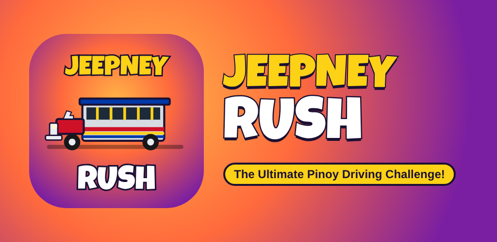

# JEEPNEY RUSH 🚌💨
**The Ultimate Pinoy Driving Challenge!**

An endless 3D arcade driving game about the Filipino jeepney: weave through Manila
traffic, jump potholes and road works, and pull into **PARA** zones to drop off and
pick up passengers, all while watching your fuel.

> **Status: Phase 1 (Playable MVP) – complete.** Everything listed under *Features* works and
> is covered by automated tests. Phases 2–5 (garage, power-ups, online features, ads/IAP,
> Play Store release) are planned in [`docs/ROADMAP.md`](docs/ROADMAP.md) and are **not**
> implemented yet. Nothing in the UI pretends otherwise.



## Features (Phase 1)

| Area | What works |
|---|---|
| Driving | 3 lanes, eased lane changes with input buffering, jump with fast-fall, emergency brake, touch-and-hold gas (faster, ×1.5 score, double fuel use) |
| Hazards | Cars, taxis, jeepneys, buses, trucks, motorcycles, tricycles (moving traffic; bikes/cars swerve with a warning), cones, barriers, potholes, road blocks, parked vehicles |
| Level generation | Procedural rows, difficulty ramps with distance; every row is checked by a lane-occupancy solver so the road is **never** impossible (verified by a bot that drives 6 km on 8 seeds without a crash) |
| Passengers | Stops on the left/right curb with waiting commuters, yellow PARA zones, boarding/alighting animations, capacity 5, destination per passenger, fares, group bonus, delivery streak multiplier, “missed stop” penalty |
| Collectibles | Coins (instanced), fuel cans; fuel runs out → the jeepney coasts to a stop |
| Health | 3 hearts, invulnerability frames, side-swipe bounce-back, crash slow-down, camera shake, sparks |
| Visuals | Procedural 3D jeepney (chrome grille, horse mascots, ornamental headlights, route sign, painted art, “GOD BLESS OUR TRIP”), Manila streets (sari-sari stores, tangled power lines, vendors, waiting sheds, pedestrian crossings), bent-world horizon, dynamic shadows, particles, speed lines |
| Audio | 100 % synthesised: diesel engine that follows speed, the signature two-tone jeepney horn (📯 button / `H`), coins, crashes, pickups; original rondalla-style music (menu + run). Music and SFX toggles are independent |
| Screens | Splash with real loading progress, main menu, HUD, pause, game over, settings, how-to-play, local records |
| Persistence | Local save with checksum + automatic backup recovery; mirrored to Android native storage |
| Android | Capacitor project (portrait, fullscreen, back button, pause on background, haptics), launcher icons, splash, release signing config |

## Controls

| Action | Mobile | Keyboard |
|---|---|---|
| Change lane | Swipe ◀ ▶ | ← → / A D |
| Jump | Swipe ▲ | ↑ / W / Space |
| Brake (or slam down mid-air) | Swipe ▼ | ↓ / S |
| Gas | Touch & hold | Hold Shift |
| Horn | 📯 button | H |
| Pause | ❚❚ button / Android back | Esc / P |

## Quick start

```bash
npm install
npm run dev          # http://localhost:5173  (add ?seed=123 for a reproducible run)
npm test             # unit tests (logic, saves, level fairness bot)
npm run test:e2e     # plays the real game in headless Chromium
npm run build        # type-check + production build to dist/
```

Android: see [`docs/ANDROID_BUILD.md`](docs/ANDROID_BUILD.md) (`npm run android:sync`, then build in Android Studio or with Gradle).

## Why Three.js + Capacitor instead of Unity?

The spec preferred Unity or Godot. This project uses **TypeScript + Three.js** wrapped as a
native Android app with **Capacitor**, because:

* It ships as a real APK/AAB for Google Play, with native plugins (haptics, lifecycle, storage, orientation) and room for AdMob, Play Billing and Play Games plugins in later phases.
* The whole game is tested automatically: unit tests for gameplay logic and an end-to-end test that boots and plays the actual game in headless Chromium.
* All art and audio are generated in code, so the download is about 1.3 MB and there's no binary asset pipeline.
* Iterating is fast: a browser refresh is the dev loop, and the same build runs on desktop for testing.

The trade-off: the game runs in the Android System WebView (WebGL 2). Performance is budgeted for that: about 140 draw calls, about 42k triangles, pooled objects and instanced coins/particles, plus a graphics-quality setting.

## Project structure

```
src/
  config.ts              all gameplay tuning in one place
  main.ts                boot sequence & main loop
  core/                  GameManager (state machine, run loop), Input, Events, Pool, Random
  game/                  World, PlayerController, TrafficManager/ObstacleManager (Hazards.ts),
                         CoinManager, PassengerManager, RoadManager, Effects, Kinds
  game/logic/            pure, unit-tested logic: SpawnDirector, Occupancy solver,
                         PassengerRoute, Collision
  art/                   procedural models & canvas textures (jeepney, traffic, scenery, props)
  render/                Renderer (camera rig, lights, quality), bent-world shader
  audio/                 AudioManager (SFX, engine, horn), Music (sequencer)
  save/                  SaveManager (checksummed saves, backup recovery)
  platform/              Capacitor integration (lifecycle, haptics, native storage)
  ui/                    UIManager + styles (all DOM screens)
tests/unit/              vitest
tests/e2e/smoke.mjs      Playwright end-to-end
android/                 Capacitor Android project
scripts/generate-assets.mjs   icons, splash, store graphics
store/                   Play Store graphics
docs/                    architecture, testing, Android build, roadmap
```

More detail: [`docs/ARCHITECTURE.md`](docs/ARCHITECTURE.md) · [`docs/TESTING.md`](docs/TESTING.md)
