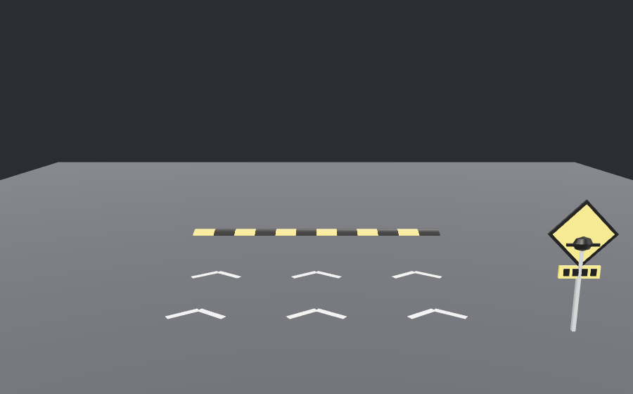
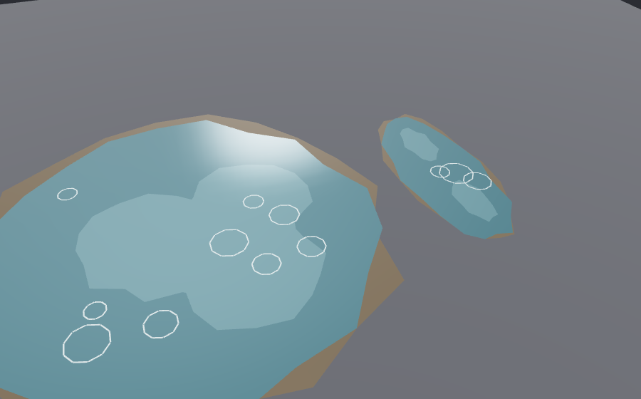

# Unity Phase 2 – Game Expansion report

## What's new
| Feature | Details |
|---|---|
| **GAS / BRAKE buttons** | Hold-to-accelerate (+30% speed, ×1.5 score) and hold-to-brake pedals, one per thumb. Multi-touch: swipe with one finger while holding a pedal. Keyboard: Shift and B/Ctrl. |
| **Passenger delivery** | Every passenger has a destination. A **green arrow** above a stop, and "N bababa" in the HUD, means riders get off there. Driving through pays fares, a group bonus and a delivery-streak multiplier (up to ×3). Missing their stop loses them ("LAGPAS!") and resets the streak. |
| **Power-ups** | Coin Magnet, Shield (blocks one crash, shown as a bubble), Turbo Boost (×1.6 speed, smash through traffic), Double Coins, Passenger Bonus (×2 fares), Repair Kit (+1 heart, or coins at full health). Each has its own pickup model, sound and a HUD timer bar. Picking one up again refreshes its timer; they don't stack. Spawns are spaced 320–560 m apart. |
| **Garage shop** | 11 jeepneys. Two are free; the other nine cost 600–8,000 coins: Manila Classic, Modern Jeepney (boxy PUV body), Cebu Express, Baguio Cruiser, Davao Explorer, Fiesta Edition (banderitas), Neon Street Racer (glowing strips), Philippine Flag Edition, Gold VIP (gold chrome). Each has its own art, roof sign and stats (seats, health, speed, handling). |
| **Upgrades** | Engine, Brakes & Steering, Armor, Passenger Capacity (up to 15 seats), Coin Bonus, Power-up Duration. 5 levels each, shared across all jeepneys. |
| **Missions** | 3 daily and 2 weekly missions, generated from the date (works offline). Progress bars, claim buttons, and a reset countdown. A red dot on the MISSIONS button shows when a reward is ready. |
| **Achievements** | 11 achievements: First Passenger, 1,000 Meters Driven, Traffic Survivor, Coin Collector, Passenger Master, 100 Deliveries Completed, Highway Legend, Power Player, Jeepney Collector, Fully Loaded, Island Hopper. Each has a coin reward. |
| **Player level / XP** | XP from distance, passengers, deliveries and power-ups. Every level-up pays coins. The level and XP bar appear on the main menu. |
| **New routes** | **Provincial Road** (rice paddies, coconut trees, bahay kubo, carabao, basketball court, chapel, mountains) unlocks at a best of 1,000 m. **Beach Highway** (sea, bangkas, umbrellas, lighthouse, resorts) unlocks at 2,500 m. Each route has its own traffic mix, stop names, sky/fog and music arrangement. |
| **Game over** | Adds deliveries, coin-bonus payout, XP, level-ups, completed missions, new achievements and unlocked routes. |

The visible seats inside the jeepney went from 5 to 10, so larger capacities show more passengers.

## Verification
| Check | Result |
|---|---|
| `dotnet test unity/Tests.DotNet` | **54/54 pass**: delivery/fares/streak/miss, power-up timers/shield/turbo/duration scaling, shop and upgrade purchases and caps, effective-stat calculation, coin bonus, XP/levels, deterministic daily/weekly missions and claiming, achievements, route unlocks, save migration v1→v2, plus all Phase 1 tests |
| Fairness bot | 8 seeds × 4 km across **all three routes** with power-ups spawning: 0 collisions |
| Mesh checks | All 11 jeepneys, power-ups, shield bubble, 6 seeds each of Manila/Provincial/Beach scenery: indices, normals, triangle winding |
| Compile check (runtime + editor) | 0 errors, 0 warnings |
| In Unity / on your phone | **Not yet.** Please test as described below. |

## Updating your Unity project (keeps your scenes and save)
1. Close Unity.
2. Download the latest ZIP from branch `ccr-5502d442-jkkg4f` and extract it.
3. Copy `unity/JeepneyRush/Assets/JeepneyRush` and paste it **onto** your project's `Assets` folder.
   When Windows asks, choose **Replace the files in the destination**.
   Don't delete the old folder first, because that would also delete the Scenes that *Setup Project* created.
4. Open Unity and wait for it to compile. Check the Console for red errors.
5. Run **Jeepney Rush ▸ Setup Project** again. It's safe to re-run: it keeps your scenes and adds the new jeepney assets and texture settings.
6. Open the **Bootstrap** scene and press Play, or build to your phone again.

Your existing coins, best score and settings carry over: the save migrates from version 1 to version 2 automatically.

## What to test on the phone
1. Hold GAS: the speed number rises, and the jeepney tilts back slightly. Hold BRAKE: it slows down. Swipe left or right while holding GAS.
2. Pick up passengers. A later stop shows a **green arrow**. Drive into that lane: "N BABA +coins" and confetti. Skip one: "LAGPAS!".
3. Grab each power-up and watch its timer in the HUD. Shield: crash into a car and you see "SHIELD!" with no heart lost. Turbo: drive through traffic.
4. Garage: buy Manila Classic (600 coins) and an Engine upgrade, select it, and play.
5. Missions: complete one and claim it. Reach 1,000 m, then switch to Provincial Road under ROUTES.

## Not in this phase (still planned)
* Paint, wheel and sticker customisation, and gems. These come with the Phase 4 cosmetics and monetisation work.
* Extra game modes (Passenger Challenge, Time Attack, City Tour).
* Online features: Supabase login, cloud save, leaderboards and server-checked rewards (Phase 3).
* "Fuel efficiency" upgrade: this version has no fuel mechanic, so it was replaced by **Power-up Duration**.

## Update 2 – visual fixes and game-feel features (from phone testing)
| Reported | Change |
|---|---|
| Grainy screen | Native-resolution rendering (removed the 85% resolution scale), MSAA 4x (2x on Low), forced anisotropic filtering, URP render scale 1, and camera post-processing **off** so template film grain/vignette volumes no longer apply. Particles use a soft round sprite instead of hard squares, speed lines are fewer and subtler, and the road and sidewalk textures are less noisy. |
| Flickering jeepney | The body's engine-shake animation ran at 38 Hz, which strobes at 30–60 fps; it's now a gentle 9 Hz sway. The damage blink is a soft 5 Hz pulse instead of a hard 12 Hz strobe. Shadow bias was raised and shadows use a single cascade to stop acne and shimmer. |
| Garage preview | The garage is now a showroom: the selected model spins on a turntable above the shop card, and switching models makes it pop in with confetti. |
| Passengers visible inside | The jeepney cabin is hollow now: floor, inner walls, ceiling lamps and grab rails. Passengers on the benches are visible through the windows and the **open rear doorway**, and up to 10 seats are shown. |
| Addictive coin effects | Coins fly into the coin counter, which bumps. The coin sound rises in pitch with your **COMBO** (counter on screen, changing colour at 10/20/30). Every 10-coin combo triggers **COIN RUSH**, a bonus coin payout with a golden fountain, its own sound and a light haptic tick. Coin sparkle bursts are bigger. |
| Passengers complain | Comic speech bubbles: crash → "ARAY KO!", "KUYA, INGAT!"… with a 60% chance a rider storms out ("BABABA NA AKO!", -1 passenger, delivery streak resets). Hard landings → "SUSMARYOSEP!". Boarding → "BAYAD PO!", alighting → "PARA PO!". |
| MMDA enforcer | After a crash, an **MMDA CHECKPOINT** sets up 140 m ahead on the sidewalk: an enforcer with a STOP paddle, a patrol bike with flashing red/blue sirens, an A-frame sign and cones. A banner says "BRAKE!" with the distance. Pass at no more than 62% of normal speed (hold BRAKE) for +150 score; speed past and you get a **TICKET** (15% of this run's coins, at least 10) plus a whistle. There's a 25 s cooldown, and the enforcer never blocks a lane. |

Tests: **57/57 pass** (adds coin combo, enforcer fine rules, angry-passenger logic). The compile check is clean.

## Update 3 – realistic obstacles, slopes and bends, Philippine weather, diesel feel
| Reported | Change |
|---|---|
| Cars, jeeps and trucks inside the PARA stop | Parked and stopped obstacles were already kept out of a stop's lane. Moving traffic could still **drive through** the zone, or swerve into it. Now a moving vehicle is only spawned, or allowed to change lanes, if it will not be inside any stop zone before the jeepney passes it. A new test drives 8 × 4 km and fails if anything is ever in a zone lane while the jeepney approaches. |
| 3 cones across all lanes | Removed. The old "jump wall" pattern (one obstacle in every lane) is gone and cones and barriers are always solid. The generator can never close all lanes with solid objects, and a test checks that. |
| A jeepney can't jump | **Jumping is removed.** Swipe up (or Space / Up arrow) now honks. Instead you get **speed humps**: a yellow-and-black striped hump across the whole road, white chevrons and a yellow HUMP sign before it, and a "HUMP AHEAD · BRAKE! 42 m" banner. Hold BRAKE so you cross at no more than 62% speed and you get **"DAHAN-DAHAN! +50"** and happy passengers. Cross too fast and the jeepney bounces hard with a camera jolt, the passengers complain ("TUMALBOG AKO!"), and there's a 30% chance one walks out. Potholes work the same way (no crash damage, but a jolt). |
| Slopes and curves, not just straight roads | The road now has **hills and bends**: the asphalt, sidewalks, curbs, ground, buildings, traffic, coins, stops and the enforcer all follow the shape. The jeepney tilts nose-up uphill. It is flat for the first ~120 m and then gradually curves. Manila has gentle flyover-like hills, the province rolls more, and the coast road winds the most. This only changes the drawing: steering is still 3 straight lanes, so the fairness guarantees stay exact. |
| Rain, typhoon and other Philippine weather | Each run moves between **MAARAW** (sunny), **UMUULAN** (rain) and **BAGYO!** (typhoon, only after 900 m and more common on the coast road), blending over about 80 m. In rain you get falling rain (slanted by wind in a typhoon), a darker sky, closer fog, a dark glossy wet road, a rain sound loop, and water spray from the tyres. In a typhoon there is also **lightning** (screen flash, light burst, haptic) followed by **thunder**. The HUD shows the weather and pops "UMUULAN! MADULAS ANG DAAN", "SIGNAL NO. 2! MAG-INGAT!" and "TUMILA NA ANG ULAN!". |
| Floods that make the road slippery | On a wet road, lane changes take up to 30% longer and the rear of the jeepney slides a little (fishtail). **Floods (BAHA)** only appear when it's wet: puddles covering 1–2 lanes, or in heavy weather a flood across the whole road. Driving through one throws up big splashes and a splash sound, slows the jeepney to 70% for 1.2 s, makes steering even slower, and the passengers react ("BASA PAA KO!"). The generator plans with the slower wet steering, and the fairness bot drives with it too. |
| Exhaust smoke and accelerator sound (new request) | Holding GAS now pours **thick black diesel smoke** ("usok") from the tail pipe, and the first press coughs out a big black puff. There's a new **diesel rev** sound, built from individual cylinder firings with uneven timing, a throaty exhaust and panel rattle, plus the engine loop pitches up and gets louder while you hold GAS. The idle loop also has diesel knock now. |

New missions and achievements: "Cross N speed humps slowly", "Drive N m in the rain", **Rain or Shine** (2,000 m wet) and **Smooth Operator** (50 smooth humps). Old saves load unchanged.

Tests: **65/65 pass**. New tests: weather schedule (starts sunny, smooth, no early typhoons, deterministic), road shape (flat start, never steeper than 12%, always straight under the jeepney), hump rules, wet steering, no all-lane walls, floods only on wet roads, PARA zones always empty, and the new sounds. The fairness bot now drives **without jumping**, with wet-road steering. The compile check against the Unity API has 0 errors.

 

**Updating:** copy `unity/JeepneyRush/Assets/JeepneyRush` over your project's `Assets/JeepneyRush` again and choose **Replace**. No new textures, so re-running Setup Project is optional. `Scripts/Runtime/Player/JumpController.cs` is now an empty placeholder so that replacing the folder overwrites the old one. You can delete it.

**Not verified here:** I can't run Unity in this environment. Everything was compile-checked against the Unity API and the game logic is unit-tested, but how the rain, lightning, bends and new sounds look and sound has to be checked on the device.

## Update 4 – full stops at PARA zones and smooth humps with the brake
| Request | Change |
|---|---|
| The jeepney must be able to stop completely | Holding **BRAKE** is now real braking (9 m/s², faster with the Brakes upgrade). The jeepney slows **all the way to 0 km/h** and stays stopped while you hold it. Release BRAKE (or hold GAS) to pull away again. The nose dips while braking and settles once stopped. Traffic behind you waits instead of driving into you. |
| Passengers only board or get off at a complete stop | Driving through a PARA zone no longer picks anyone up. Stop in the zone's lane, fully (speed ≤ 0.5 m/s, for 0.35 s), and then people board and get off. The jeepney **waits while they move** (0.3 s per passenger, banner "SAKAY / BABA... HINTAY LANG") and then shows "ARANGKADA!". If you drive past without stopping, waiting commuters are left behind, and riders who wanted to get off there are lost as before ("LAGPAS!"). The banner guides you: "PARA ZONE 42 m · BRAKE TO STOP", then "PARA! HOLD BRAKE · FULL STOP" inside the zone. Even at top speed with GAS, the stopping distance (≈54 m) fits easily between stops. |
| Brake at a hump = smooth, no complaints | Crossing a hump **while braking** now counts as smooth (unless you're still faster than 90% of normal speed), just like crossing already slow. You get "DAHAN-DAHAN! +50" and happy riders. Passengers complain and may walk out **only** if you didn't slow down. |

Tests: **68/68 pass**. New tests: braking-at-hump rules, board only when stopped in the zone's lane, and stopping distance. The compile check has 0 errors.

## Update 5 – reversing back to a PARA stop, forgiving zone lines
| Request | Change |
|---|---|
| Keep holding BRAKE to reverse back to the stop | After a full stop, **keep holding BRAKE for 0.6 s** and the jeepney backs up slowly (up to 4 m/s) with a truck-style **reversing beeper** and an "ATRAS!" banner. If you overshoot a stop, the banner says "LAGPAS SA PARA! HOLD BRAKE TO REVERSE". The jeepney stops on its own as soon as it touches the PARA zone, and the passengers board or get off. You can reverse up to 25 m behind the farthest point reached. A **parking sensor** beeps faster near an obstacle behind you and stops the reverse just before you touch it. Traffic behind gives way. Reversing never takes away score, and the run's distance is the farthest point reached. A stop only counts as missed ("LAGPAS!") once it's beyond reversing reach. |
| Board even if not exactly inside the lines | The jeepney only has to **touch** the zone. It can stand on the painted lines, straddle the lane line (even mid lane change), or stop up to 1.5 m short of or past the box. |

Tests: **68/68 pass**, and the zone test now covers straddling, bumper-on-the-line, rolling past and the reversing reach. The compile check has 0 errors.

## Update 6 – fare passing inside the jeepney, smooth lane changes with turn signals
| Request | Change |
|---|---|
| Fare collection animation inside the jeep | The jeepney now has a **driver** behind the steering wheel (front left). When a passenger boards, they sit down and then hand their fare (a folded peso bill with coins) forward. It is **passed hand to hand** up the bench ("Pakiabot po!"): each rider on the way leans into the aisle to take it, up to 3 hand-overs, each a small arc. The driver turns to take it, you hear coins clinking, a coin flies to the HUD counter, and sometimes the driver says "SALAMAT!". Several riders boarding together pay one after another. |
| Smooth, slow turns with turn signals | Lane changes now take **0.42 s** (was 0.22 s) with a smooth ease-in/ease-out like a driver turning the wheel. The nose points into the turn and the body leans gently. The **amber turn signals** on the matching side (front and rear corners) **blink about 2.5× per second** with a relay "tik-tak" sound for the whole turn and briefly after. Swipe left → left signals, swipe right → right signals. Wet roads make the turn even slower (up to 0.55 s). The obstacle generator and the fairness bot use the new timing, so every situation is still escapable. |

Your existing `Resources/GameBalance.asset` still holds the old 0.22 s lane change, so the game **upgrades it automatically** on load (`balanceVersion` 3). You don't have to edit it by hand.

Tests: **68/68 pass** (the fairness bot uses the slower, smoothed lane change). The compile check has 0 errors.
