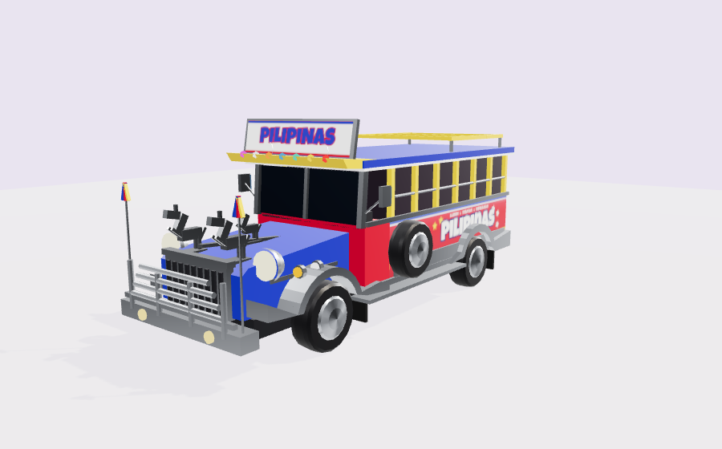

# Jeepney Rush — Unity 6 project (Phase 1 MVP)

Unity 6 LTS · URP · C# · UI Toolkit · Input System (legacy input also supported) · Android portrait.



> **Status – read this first.** The game code, assets and editor tooling are complete for Phase 1
> and everything below **compiles** against Unity reference assemblies. The engine-free gameplay
> logic passes 35 automated tests. The Unity project itself has **not been opened, played or built
> in the Unity Editor yet** (Unity cannot run in the environment it was written in). Milestone 7
> (running it, building the Android APK/AAB and testing on devices) still has to happen on a machine
> with Unity. See [`../docs/UNITY_PHASE1_REPORT.md`](../docs/UNITY_PHASE1_REPORT.md) for what is
> verified, what is not, and the known risks.

## Open and run

**Option A – start from a fresh Unity 6 URP project (recommended)**
1. Unity Hub → *New project* → **Universal 3D** template (Unity 6000.0 LTS or newer).
2. Close Unity. Copy `unity/JeepneyRush/Assets/JeepneyRush` into the new project's `Assets/` folder.
3. Reopen the project. If prompted to enable the new Input System backend, either answer works:
   the game supports both input backends.
4. Menu **Jeepney Rush ▸ Setup Project**. This configures player settings, textures, materials,
   ScriptableObjects, the three scenes and Build Settings.
5. Open `Assets/JeepneyRush/Scenes/Bootstrap.unity`, set the Game view to a portrait aspect
   (for example 1080x1920), and press **Play**.

**Option B – open this folder directly**
Open `unity/JeepneyRush` in Unity Hub (Unity 6 LTS). `Packages/manifest.json` brings in URP,
Input System and the Test Framework. Then run **Jeepney Rush ▸ Setup Project**. In this setup it
also creates and assigns a mobile URP asset if the project has none.

You can also press Play in `MainMenu` or `Gameplay`. The persistent managers create themselves
(`Bootstrap.CreateSystems`), so every scene works on its own.

## Controls
| Action | Mobile | Desktop |
|---|---|---|
| Change lane | swipe left / right | ← → (A D) |
| Jump | swipe up | Space / ↑ (W) |
| Brake (slam down when airborne) | swipe down | ↓ (S) |
| Horn | 📯 button | H |
| Pause | ❚❚ button / Android back | Esc / P |

## Build for Android
* Menu **Jeepney Rush ▸ Build ▸ Android APK (development)** or **… ▸ Android AAB (release)**.
* Command line:
  `Unity -batchmode -quit -projectPath unity/JeepneyRush -executeMethod JeepneyRush.EditorTools.BuildTools.BuildAab`
* Release signing: set the keystore under *Player ▸ Publishing Settings*, or set the environment
  variables `JR_KEYSTORE`, `JR_KEYSTORE_PASS`, `JR_KEY_ALIAS` and `JR_KEY_PASS` (never commit them).
* Change the package id `ph.jeepneyrush.game` (`ProjectSetup.ConfigurePlayer`) to your own before publishing.
* Settings applied: portrait only, IL2CPP, ARM64 + ARMv7, min API 24, Vulkan + GLES3, linear colour.

## Architecture
```
Assets/JeepneyRush/
  Scripts/Logic/        JeepneyRush.Logic – engine-free C# (no UnityEngine): balance config, level
                        generator + fairness solver, passengers, collision maths, saves, audio synth,
                        procedural mesh builders. Unit-tested outside Unity.
  Scripts/Runtime/      JeepneyRush – MonoBehaviours
    Core/               GameManager (state machine), Bootstrap, SceneLoader, PoolManager, Services,
                        GameEvents, GameplaySession (frame order), MainMenuController
    Config/             GameBalance & JeepneySpec ScriptableObjects
    Player/             PlayerController, PlayerInputHandler, LaneController, JumpController, CollisionHandler
    Camera/             CameraController (chase cam, tilt, FOV, shake, menu orbit)
    World/              RoadManager, RoadSegment, DifficultyManager, ScoreManager, LevelSpawner, EnvironmentSetup
    Traffic/ Obstacles/ TrafficManager, ObstacleManager, Hazard
    Collectibles/       CoinManager, Coin
    Passengers/         PassengerManager, PassengerStopView
    UI/                 UIManager (UI Toolkit, every screen), UiKit
    Audio/              AudioManager
    Save/               SaveManager (versioned JSON, checksum, backup)
    Art/                ModelLibrary (MeshData → Mesh), MaterialLibrary (URP materials, palette atlas)
    VFX/ Platform/ Utilities/
  Scripts/Editor/       ProjectSetup (one-click setup), BuildTools (APK/AAB)
  Tests/EditMode/       NUnit tests (run in Unity's Test Runner and with `dotnet test`)
  Resources/            Textures (generated), Fonts (OFL), materials/config created by Setup
```
* **States:** Loading → MainMenu → Starting → Playing ⇄ Paused → GameOver (`GameManager`).
  Systems react through `GameEvents`, not through direct references.
* **Frame order** (`GameplaySession.Update`): input → speed → player → spawning → world → camera, audio → HUD.
  Collisions arrive through physics triggers (`CollisionHandler.OnTriggerEnter`).
* **World:** the jeepney stays at z = 0 and the world scrolls toward −Z. 40 m road segments recycle
  (7 active). Traffic, obstacles, coins, stops and commuters are all pooled (`PoolManager`).
* **Fair generation:** each spawned row is validated by `LaneOccupancy.IsPassable`, which predicts
  when each lane is blocked and checks that a human with real steering time (lane change plus slack)
  can always get through. The validation runs at both the current speed and the speed the player
  will have when the row arrives. Jump walls (cones, barriers, potholes across all lanes) only
  appear after 500 m, where the jump arc is guaranteed to clear them.
* **Art:** every 3D model is built procedurally in C#, modeled on the reference photos: the
  Pilipinas Classic (chrome fenders, sun-and-stars art, PILIPINAS roof sign, side spare tyre, rear
  ladder) and the San Juan Express (purple, sunburst stripes, beaded antennas, red mud flaps).
  Flat colours come from a single 16×16 palette texture atlas, so most geometry shares one URP Lit
  material and batches with the SRP Batcher. Signs and art panels use generated texture atlases.
* **Audio:** all sounds and both music loops (original rondalla-style instrumentals) are synthesised
  at load. The signature two-tone jeepney horn is on the 📯 button.
* **Tuning:** every balancing value is in **Resources/GameBalance.asset**: speed 12→24 m/s, lanes
  3.2 m, lane change 0.22 s, jump 0.65 s / 1.5 m, 3 health, the difficulty curve (0/500/1000/2000/3000 m),
  spawning, passengers and rewards.

## Tests and tools (no Unity needed)
```bash
dotnet test unity/Tests.DotNet                                       # 35 logic/geometry/audio tests
./unity/tools/fetch-unity-refs.sh && dotnet build unity/tools/CompileCheck   # compile-check all Unity C#
node scripts/unity-textures.mjs                                      # regenerate texture atlases & UI art
dotnet run --project unity/Tools.Preview -- preview                   # export models to preview/models.json
```
To look at models in a browser, serve the repo root (`python3 -m http.server`) and open
`/unity/Tools.Preview/preview.html?data=/preview/models.json&model=jeepney_sanjuan&yaw=30`.
